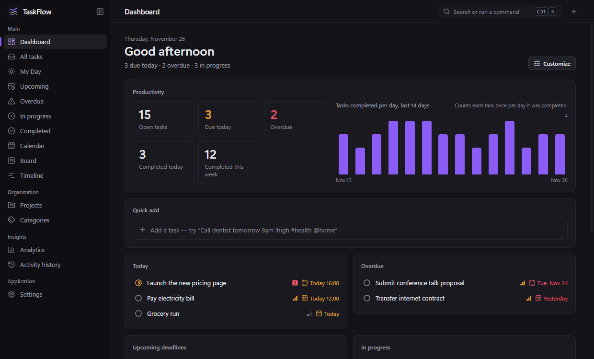
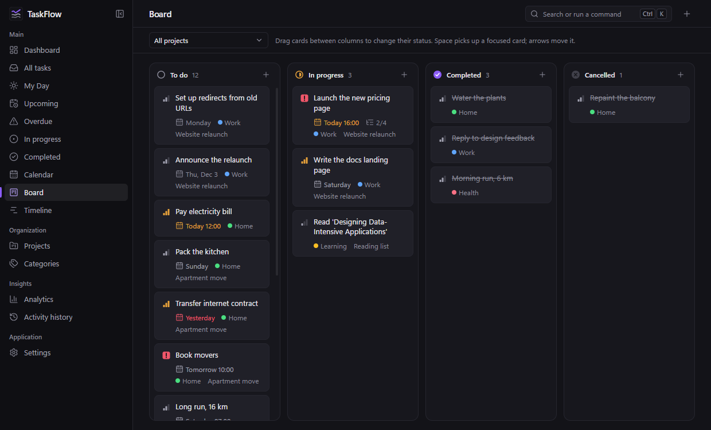
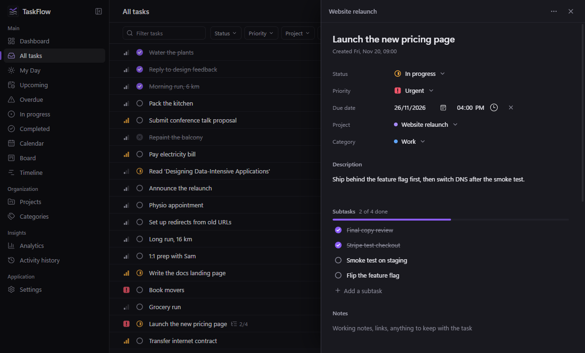
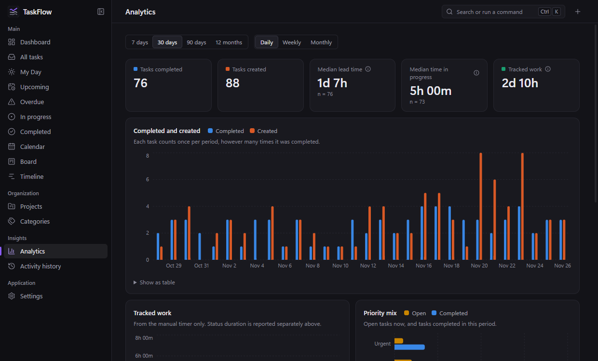
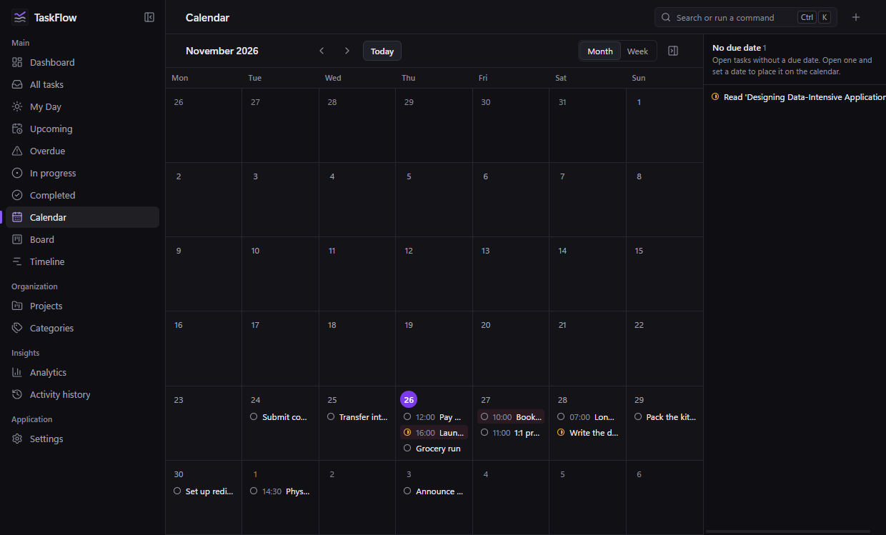
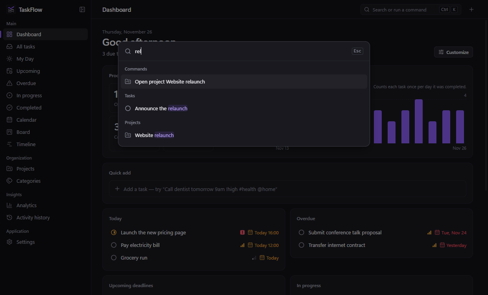
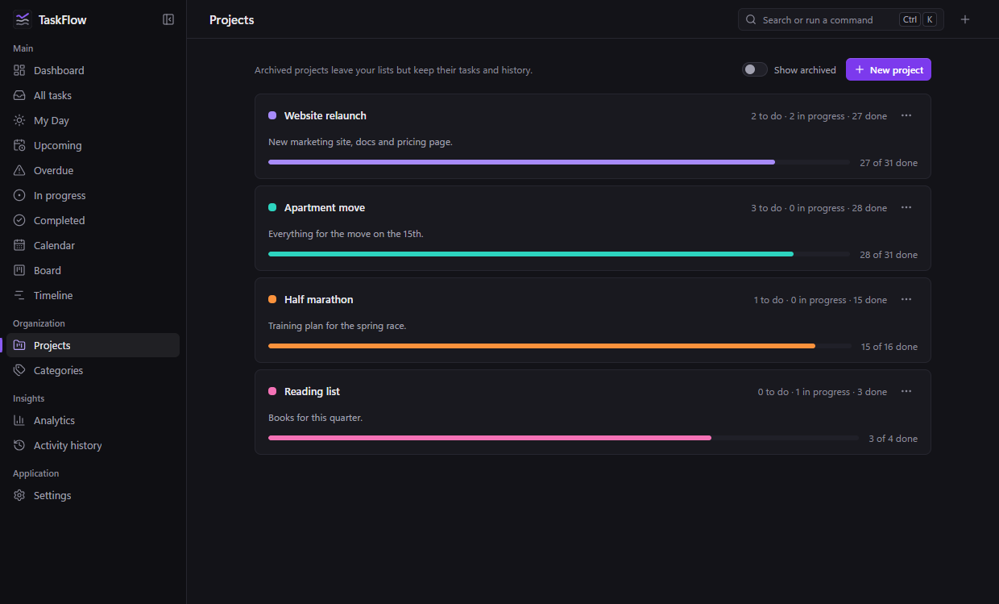
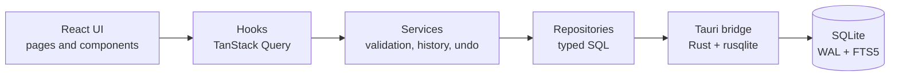

<div align="center">


# TaskFlow

**A fast, keyboard-friendly task manager for Windows that keeps everything on your PC.**

No account, no cloud, no tracking. Your tasks, history and time live in one SQLite file on your machine, and the app works fully offline.


**[Download 1.0.0](https://github.com/Zed124/TaskFlow/releases/latest)** · [Features](#features) · [Screenshots](#screenshots) · [Getting started](#getting-started) · [How it works](#how-it-works) · [Docs](#documentation)

<br />



</div>

## Why TaskFlow

Most task apps either live in the browser or want your data on their servers. TaskFlow is a native
Windows app that starts instantly, sits in the tray, and remembers everything you did, including
every status change, every completion and every minute you tracked, without sending any of it anywhere.

- **Your history is kept.** Reopening a task never erases the earlier completion. Every change is recorded in the task's history.
- **Two kinds of time, kept separate.** Time a task spent _in progress_ is measured automatically from status changes. Time you actually _worked_ comes from the manual timer. The two are never added together.
- **Built for the keyboard.** Quick Add understands dates, times, priorities, projects and categories. Ctrl+K opens search and commands, and Ctrl+Z undoes your last change.

## Features

|                            |                                                                                                                                                 |
| -------------------------- | ----------------------------------------------------------------------------------------------------------------------------------------------- |
| 📝 **Tasks**               | Status, priority, due date and time, project, category, description, notes and subtasks, with a full change history and your own timeline notes |
| ⚡ **Quick Add**           | Type `Call dentist tomorrow 9am !high #health @home` and the date, time, priority, category and project are filled in for you                   |
| 🗂️ **Views**               | Dashboard (customizable), My Day, Upcoming, Overdue, In progress, Completed, All tasks with filters, Board, Calendar (month and week), Timeline |
| 📁 **Organize**            | Projects with progress bars and archiving, color-coded categories                                                                               |
| ⏱️ **Time tracking**       | Start, pause, resume and stop a work timer from the app or the tray                                                                             |
| 📊 **Analytics**           | Completed vs. created trends, lead time, time in progress, tracked work and priority mix, by day, week or month                                 |
| 🪟 **Windows integration** | System tray with timer controls, close to tray, start with Windows, due-time reminders, overdue alerts, daily summary, single instance          |
| 🛟 **Data safety**         | Automatic daily backups with retention, export, checked restore with a safety copy, CSV export, undo                                            |
| ♿ **Accessible**          | Every page passes axe-core WCAG 2.1 A/AA checks, contrast is at least 4.5:1, and everything works by keyboard                                   |

## Screenshots

<table>
  <tr>
    <td width="50%"></td>
    <td width="50%"></td>
  </tr>
  <tr>
    <td align="center"><b>Board</b>: drag cards between columns, or use the keyboard</td>
    <td align="center"><b>Task panel</b>: details, subtasks, notes and history</td>
  </tr>
  <tr>
    <td></td>
    <td></td>
  </tr>
  <tr>
    <td align="center"><b>Analytics</b>: trends, lead time and tracked work</td>
    <td align="center"><b>Calendar</b>: month and week views</td>
  </tr>
  <tr>
    <td></td>
    <td></td>
  </tr>
  <tr>
    <td align="center"><b>Ctrl+K</b>: search everything and run commands</td>
    <td align="center"><b>Projects</b>: progress at a glance</td>
  </tr>
</table>

## Keyboard

| Shortcut                          | Action                                  |
| --------------------------------- | --------------------------------------- |
| <kbd>Ctrl</kbd> + <kbd>K</kbd>    | Search tasks and projects, run commands |
| <kbd>Ctrl</kbd> + <kbd>N</kbd>    | New task                                |
| <kbd>Ctrl</kbd> + <kbd>Z</kbd>    | Undo the last change                    |
| <kbd>Ctrl</kbd> + <kbd>B</kbd>    | Show or hide the sidebar                |
| <kbd>Space</kbd>, then arrow keys | Pick up and move a card on the Board    |

### Quick Add syntax

All parts are optional and can go anywhere in the text.

| Type     | Examples                                                       |
| -------- | -------------------------------------------------------------- |
| Date     | `today`, `tomorrow`, `mon`…`sun`, `2026-12-01`, `+3d`, `+2w`   |
| Time     | `14:30`, `9am`, `5:15pm` (a time without a date means today)   |
| Priority | `!low`, `!medium`, `!high`, `!urgent` (or `!l` `!m` `!h` `!u`) |
| Project  | `@Website`                                                     |
| Category | `#Work`                                                        |

## Getting started

### Install

Download `TaskFlow_1.0.0_x64-setup.exe` from the [latest release](https://github.com/Zed124/TaskFlow/releases/latest)
and run it. It installs for your user only, so no administrator rights are needed. An `.msi` is
also available.

The installer isn't code-signed yet, so Windows SmartScreen may say "Windows protected your PC".
Choose **More info**, then **Run anyway**.

### Build from source

#### Requirements

- Windows 10 or 11 with WebView2 (built into Windows 11)
- [Node.js](https://nodejs.org/) 22.13 or later
- [Rust](https://rustup.rs/) stable (MSVC) and Visual Studio 2022 Build Tools with the C++ workload

#### Run and build

```powershell
npm install
npm run tauri dev      # run the app in development
npm run check          # typecheck, lint and tests
npm run tauri build    # build the installers
```

The build puts an NSIS installer (`TaskFlow_1.0.0_x64-setup.exe`, per-user, no admin rights needed) and an `.msi` in `src-tauri\target\release\bundle\`.

Your data lives in `%APPDATA%\com.taskflow.app`, and automatic backups go to `Documents\TaskFlow Backups`.

## How it works



- **The UI never touches SQL.** Pages call hooks, hooks call services, services call repositories.
- **Every write is one transaction**, including the history events it produces.
- **History is append-only.** Completions, status intervals and work sessions are never rewritten, and undo writes a new compensating change instead of deleting anything.
- **Rust stays thin.** It handles the database bridge, tray, window and file access. All business logic is TypeScript, so it is tested against the real migrations on an in-memory SQLite database.

**Stack:** Tauri 2 · React 19 · TypeScript (strict) · Vite · Tailwind CSS v4 · SQLite (rusqlite) · TanStack Query · Zustand · Zod · Radix UI · cmdk · dnd-kit · Recharts · i18next

## Quality

- **117 TypeScript tests and 12 Rust tests**, covering task history, completions, subtasks, search, filters, the board, time tracking, analytics, notifications, backup and restore, CSV export, migrations and settings.
- **Tested at scale:** a performance check against 10,000 tasks with full history. Most queries finish in under 10 ms, and long lists render only their visible rows.
- **Accessibility audit** with axe-core on every page, the task panel, the create dialog and the command palette.

```powershell
npm run check        # typecheck, lint and tests
npm run test:rust    # Rust tests
npm run a11y         # accessibility audit (with the app running)
```

## Documentation

| Document                                               | What's in it                                             |
| ------------------------------------------------------ | -------------------------------------------------------- |
| [Architecture](docs/architecture.md)                   | Layers, database bridge, app lifecycle, testing strategy |
| [Database](docs/database.md)                           | Schema, invariants, event types                          |
| [Roadmap](docs/roadmap.md)                             | What each phase delivered and what's next                |
| [Manual test checklist](docs/manual-test-checklist.md) | Windows-only behavior: tray, autostart, notifications    |
| [Release notes](RELEASE_NOTES.md)                      | What's in 1.0.0 and known limitations                    |
| [AGENTS.md](AGENTS.md)                                 | Conventions and rules for contributors and coding agents |

## Roadmap

Recurring tasks, sync between devices and more languages aren't in 1.0. The data model and text
resources are ready for them. See the [roadmap](docs/roadmap.md) for details.

<div align="center">
<br />
<sub>The screenshots show sample data.</sub>
</div>
